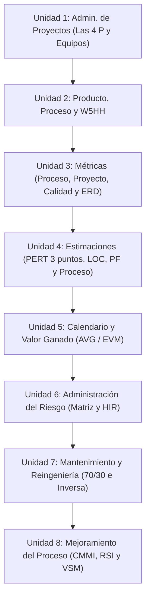
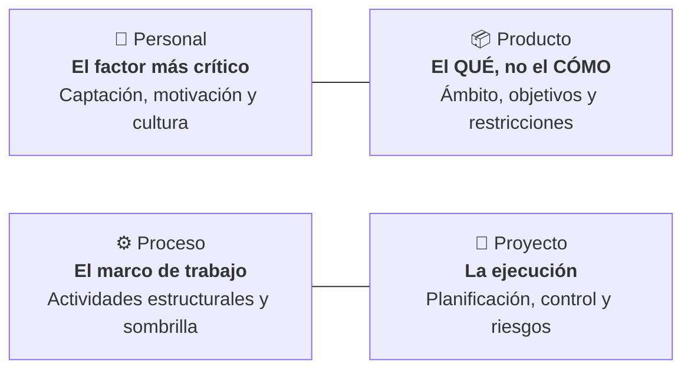
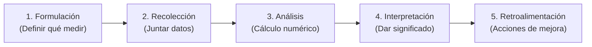
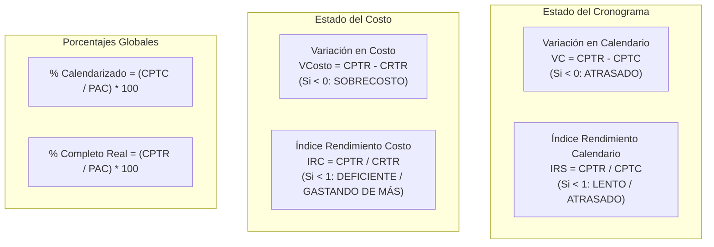
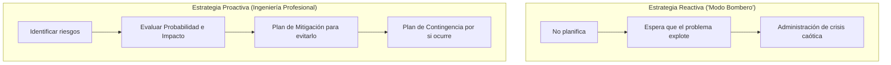
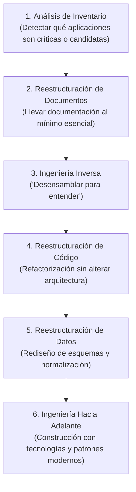
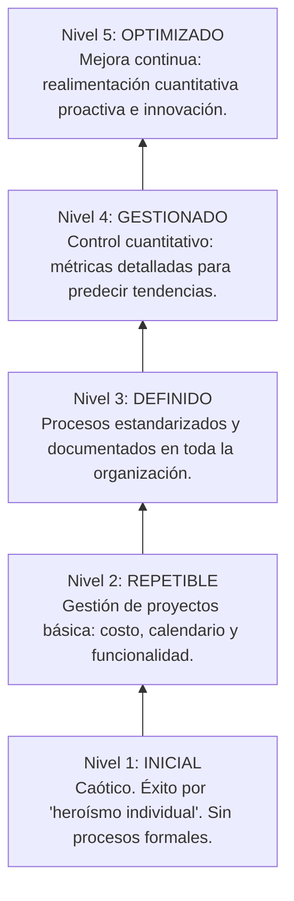
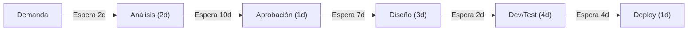

# 🚀 Guía Maestra de Estudio: Gestión de Desarrollo de Software
> **Carrera:** Tecnicatura Universitaria en Programación  
> **Bibliografía base:** Roger S. Pressman, *Ingeniería del Software: Un Enfoque Práctico* (7ª Edición).

---

## 🗺️ Mapa de Ruta del Examen (Las 8 Unidades)

---

# 📘 UNIDAD 1: Administración de Proyectos de Software

### 1. ¿Qué es la Administración del Proyecto?
Es la **planificación, monitoreo y control** del personal, procesos y acciones requeridas a medida que el software evoluciona desde una idea inicial hasta su despliegue operativo completo.

### 2. Las "Cuatro P" de la Gestión (Pilares Fundamentales)

* **Personal:** Es el recurso más determinante. Involucra motivar, coordinar, capacitar, compensar y crear una cultura sana de equipo.
* **Producto:** Se enfoca en definir el **ámbito (scope)** y objetivos. *"¿QUÉ debe resolver el software?"* antes de definir *"¿CÓMO se va a programar?"*. Sin un alcance claro, las estimaciones fracasan.
* **Proceso:** Provee el marco de actividades metodológicas (comunicación, planeación, modelado, construcción, despliegue) combinadas con **actividades sombrilla** (QA, gestión de configuración, métricas).
* **Proyecto:** La planificación y control sistemático para manejar la complejidad inherente, evitando desvíos de tiempo, costos y calidad. (El estudio de Capers Jones de 250 grandes proyectos reveló que solo ~10% terminan a tiempo y en presupuesto sin sobrecostos; la mayoría sufre grandes desvíos si no se gestionan).

### 3. Participantes Clave (Stakeholders)
1. **Usuarios finales:** Quienes usarán el software en su día a día.
2. **Clientes:** Quienes financian y especifican los requerimientos del negocio.
3. **Profesionales (Desarrolladores/Ingenieros):** Quienes aportan las capacidades técnicas de construcción.
4. **Gerentes de proyecto (Técnicos):** Planifican, organizan, motivan y controlan las actividades técnicas del equipo.
5. **Gerentes ejecutivos:** Definen el rumbo estratégico del negocio y proporcionan patrocinio.

### 4. Estructura de Equipos y Dinámica Ágil
* **Equipo $\neq$ Grupo:** Un equipo de alto rendimiento tiene confianza mutua, roles claros y autonomía.
* **Ambientes tóxicos a evitar:** Ritmo de trabajo frenético, frustración por falta de herramientas/autonomía, roles ambiguos, procesos fragmentados y exposición repetida al fracaso.
* **El antídoto ágil:** Equipos pequeños, autogestionados, motivados, con entregas incrementales tempranas, comunicación directa e informal (reuniones diarias / *dailies*) y mínimos artefactos burocráticos.

---

# 📘 UNIDAD 2: El Producto, El Proceso y El Proyecto

### 1. El Producto y la Descomposición del Problema
Cuando el cliente pide estimaciones sin tener especificaciones finales, la única salida profesional es **acotar el ámbito del producto**:
* **Contexto:** ¿Cómo encaja en el ecosistema de la empresa? ¿Qué restricciones técnicas impone?
* **Objetivos de información:** Datos de entrada requeridos y datos de salida generados.
* **Función y desempeño:** Qué transformaciones realizan los algoritmos y qué velocidad/escalabilidad demandan.
* **Descomposición:** Se divide el problema en dos ejes: **Funcionalidad/Contenido** (qué hace) y **Proceso** (cómo se organizará el trabajo para construirlo).

### 2. Matriz de Fusión Producto-Proceso
Cruza las **Actividades del Marco Conceptual** con las **Funciones del Software**:

| Funciones del Producto \ Marco | Comunicación | Planificación | Modelado | Construcción | Despliegue |
| :--- | :---: | :---: | :---: | :---: | :---: |
| **Autenticación y Perfil** | Tarea/Esfuerzo | Tarea/Esfuerzo | Tarea/Esfuerzo | Tarea/Esfuerzo | Tarea/Esfuerzo |
| **Procesamiento de Pagos** | Tarea/Esfuerzo | Tarea/Esfuerzo | Tarea/Esfuerzo | Tarea/Esfuerzo | Tarea/Esfuerzo |
| **Reportes y Auditoría** | Tarea/Esfuerzo | Tarea/Esfuerzo | Tarea/Esfuerzo | Tarea/Esfuerzo | Tarea/Esfuerzo |

> [!TIP]
> En cada celda, el gerente estima los recursos, fechas de inicio y fin, y los productos operativos (entregables) resultantes.

### 3. El Principio W5-HH (Barry Boehm)
Siete preguntas de sentido común que definen el plan del proyecto sin importar su tamaño:
1. **Why (¿Por qué?):** Justificación de negocio.
2. **What (¿Qué?):** Funcionalidad y alcance.
3. **When (¿Cuándo?):** Fechas, hitos y cronograma.
4. **Who (¿Quién?):** Responsables técnicos y roles.
5. **Where (¿Dónde?):** Ubicación organizativa y entorno técnico.
6. **How (¿Cómo?):** Enfoque técnico y modelo de proceso a seguir.
7. **How much (¿Cuánto?):** Recursos, presupuesto y esfuerzo requerido.

### 4. Los 5 Enfoques de Sentido Común
1. **Comenzar con el pie derecho:** Comprender bien el problema, alinear expectativas y armar el equipo adecuado.
2. **Mantener la cantidad de movimiento (momentum):** Proteger al equipo de distracciones ejecutivas, bajar rotación y priorizar calidad.
3. **Seguir la pista al progreso:** Basarse en métricas objetivas (ej. Valor Ganado), no en impresiones subjetivas.
4. **Tomar decisiones inteligentes:** Reutilizar componentes existentes, simplificar la arquitectura y dar colchón a tareas riesgosas.
5. **Análisis Post-Mortem:** Documentar lecciones aprendidas al terminar.

---

# 📘 UNIDAD 3: Métricas de Proceso, Proyecto y Producto

### 1. Jerarquía Conceptual (Pregunta típica de examen)
* **Medida:** Indicio cuantitativo de extensión, cantidad o capacidad (ej: número de líneas de código escritas = 1.500 LOC).
* **Medición:** El acto o método operativo de recolectar la medida (ej: correr un script contador de líneas).
* **Métrica:** Medida cuantitativa del grado en que un sistema posee un atributo determinado, relacionando dos o más medidas (ej: densidad de defectos = defectos / KLOC).

### 2. Las 5 Actividades de la Medición

### 3. Clasificación de Métricas

| Tipo | Alcance | Finalidad | Principio de Oro |
| :--- | :--- | :--- | :--- |
| **Métricas de Proceso** | Estratégicas (todos los proyectos a largo plazo) | Mejorar la madurez de la organización (CMMI) | **NUNCA usar métricas para evaluar o amenazar a individuos.** Deben ser privadas a nivel individual y consolidadas a nivel organizacional. |
| **Métricas de Proyecto** | Tácticas (el proyecto actual) | Ajustar cronograma, comparar avance real vs previsto y mitigar riesgos | Se usan para calibrar estimaciones y tomar decisiones operativas día a día. |
| **Métricas de Producto** | Técnicas (entregables y software) | Evaluar calidad técnica, mantenibilidad, complejidad | Miden el código, diseño y especificaciones. |

### 4. Normalización de Métricas
Permite comparar proyectos de distinto tipo traduciéndolos a una base común:
* **Orientadas al tamaño:** Basadas en **Líneas de Código (LOC)** o páginas de documentación (ej: defectos/KLOC, \$ / LOC).
* **Orientadas a la función:** Basadas en **Puntos de Función (PF)** (independientes del lenguaje de programación).
* **Métricas de Calidad Clave:**
  - **Exactitud:** Ausencia de fallas en producción por unidad de tiempo.
  - **Mantenibilidad:** Facilidad de reparar o modificar ante un cambio (ej. tiempo medio de cambio).
  - **Integridad:** Resistencia a ataques ($Integridad = [1 - (amenaza \times (1 - seguridad))]$).
  - **Usabilidad:** Facilidad de uso medida por encuestas y tiempos de tarea.

### 5. Eficiencia de Remoción del Defecto (ERD) ⭐ *Fórmula Clave de Examen*

$$ERD = \frac{E}{E + D}$$

* **$E$**: Errores encontrados **antes** de entregar el software (durante desarrollo, pruebas, revisiones).
* **$D$**: Defectos reportados por el cliente o usuario **después** de la entrega (en producción).
* **Interpretación:** Si $ERD \to 1$ (o 100%), significa que los filtros de calidad retuvieron casi todos los fallos antes de que llegaran al usuario final.

---

# 📘 UNIDAD 4: Estimaciones de Proyectos

### 1. La Realidad de Estimar
La estimación nunca es exacta; es una predicción sustentada en datos históricos, descomposición y experiencia. Se busca una **aproximación razonable**, no una falsa certeza matemática.

### 2. Recursos Necesarios (Las 3 Categorías)
1. **Personal:** Roles requeridos, habilidades técnicas, disponibilidad y huso horario. (*Regla: Primero se estima el esfuerzo; recién después se define el número de personas*).
2. **Entorno (EIS):** Hardware, software de soporte, redes y servidores requeridos.
3. **Software Reutilizable:**
   - **COTS (Commercial Off-The-Shelf):** Librerías o productos comerciales de terceros listos para usar (bajo esfuerzo).
   - **Experiencia completa:** Componentes propios de proyectos previos que calzan 100% sin modificar.
   - **Experiencia parcial:** Componentes previos que requieren adaptación (aumenta el riesgo).
   - **Componentes nuevos:** Software hecho desde cero para este proyecto.

### 3. Estimación por Tres Puntos (Fórmula PERT) ⭐

$$S = \frac{S_{opt} + 4 \cdot S_m + S_{pes}}{6}$$

* $S_{opt}$: Estimación optimista (el mejor de los casos).
* $S_m$: Estimación más probable (lo más realista).
* $S_{pes}$: Estimación pesimista (el peor de los casos).

### 4. Estimación por Puntos de Función (PF)
Mide la funcionalidad entregada al usuario basándose en 5 características del dominio de información, ponderadas por su complejidad (Simple, Media, Compleja):
1. **Entradas Externas (EE):** Formularios, pantallas donde entran datos que modifican el sistema.
2. **Salidas Externas (SE):** Pantallas de reportes, gráficos o mensajes generados.
3. **Consultas Externas (CE):** Búsquedas en línea que recuperan datos sin alterar la base de datos.
4. **Archivos Lógicos Internos (ALI):** Tablas maestras o entidades del modelo dentro de los límites del sistema.
5. **Archivos de Interfaz Externa (AIE):** Archivos o tablas compartidas o provistas por sistemas externos (ej: API bancaria).

> Para **WebApps**, se adapta: Entradas = Formularios/pantallas; Salidas = Páginas estáticas/dinámicas y reportes; Tablas = Tablas BD / JSON / XML; Consultas = Peticiones a APIs o llamadas orientadas a mensajes.

### 5. Reconciliación de Estimaciones
Cuando se aplican dos técnicas independientes (ej. Estimación por LOC/PF vs Estimación basada en actividades de proceso) y dan valores muy distantes, **se debe investigar la causa** (¿se entendió mal el alcance?, ¿los datos históricos de productividad no aplican a esta tecnología?) y **reconciliar** a un valor consensuado antes de comprometer fechas.

---

# 📘 UNIDAD 5: Calendario del Proyecto y Análisis de Valor Ganado

### 1. Cronograma, Red de Tareas y Ruta Crítica
* **Calendario Macroscópico (Global):** Vista de alto nivel que muestra las iteraciones o grandes bloques del proyecto a lo largo de semanas o meses.
* **Calendario Detallado:** Descompone cada acción macroscópica en tareas concretas asignadas a personas, con fecha de inicio, fin y dependencias.
* **Ruta Crítica:** Cadena de tareas secuenciales dependientes que no admiten holgura: **si una tarea en la ruta crítica se atrasa un día, todo el proyecto se atrasa un día**.

### 2. Análisis del Valor Ganado (AVG / EVM) ⭐⭐⭐ *Eje Central de Examen*

#### Las 4 Variables Base:

| Sigla en Español | Término Internacional | Significado Práctico |
| :--- | :--- | :--- |
| **PAC** | **BAC** (*Budget at Completion*) | **Presupuesto al Concluir:** Esfuerzo total estimado para el 100% del proyecto (en horas o persona-días). |
| **CPTC** | **PV** (*Planned Value*) | **Costo Presupuestado del Trabajo Calendarizado:** Lo que el plan decía que deberíamos haber completado a la fecha de hoy. |
| **CPTR** | **EV** (*Earned Value*) | **Costo Presupuestado del Trabajo Realizado (Valor Ganado):** El valor presupuestado de las tareas que efectivamente se terminaron a hoy. |
| **CRTR** | **AC** (*Actual Cost*) | **Costo Real del Trabajo Realizado:** El esfuerzo/horas reales que el equipo gastó en hacer ese trabajo. |

#### Fórmulas de Índices y Variaciones:

---

# 📘 UNIDAD 6: Administración del Riesgo

### 1. Naturaleza del Riesgo
Un riesgo es un **problema potencial**: puede ocurrir o no. Presenta siempre dos características: **Incertidumbre** (probabilidad) y **Pérdida** (impacto).

### 2. Estrategias: Reactiva vs Proactiva

### 3. Categorías de Riesgo
* **Riesgos de Proyecto:** Amenazan los plazos, el presupuesto o el personal (ej: rotación de programadores, desvíos de calendario).
* **Riesgos Técnicos:** Amenazan la calidad, rendimiento o arquitectura (ej: tecnología inmadura, ambigüedad en requisitos, problemas de interfaz).
* **Riesgos Empresariales:** Amenazan la viabilidad económica o comercial (ej: pérdida de financiamiento, cambios en la estrategia de la compañía, producto que nadie compra).

### 4. Otra Clasificación Crucial
* **Conocidos:** Se detectan tras revisar cuidadosamente el plan y el entorno técnico (ej: fechas poco realistas, falta de requisitos documentados).
* **Predecibles:** Se extrapolan de la experiencia de proyectos anteriores (ej: rotación típica de personal, clientes que demoran en dar feedback).
* **Impredecibles:** Imposibles de prever por adelantado (ej: catástrofes naturales, quiebra sorpresiva de un proveedor crítico).

### 5. Matriz de Riesgo y Hoja de Información de Riesgo (HIR)
* Se calcula el valor de riesgo: $R = Probabilidad \times Impacto$.
* Se traza una **línea de corte**: los riesgos que caen en la zona crítica (alta probabilidad y alto impacto) van a la **Hoja de Información de Riesgo (HIR)** y reciben:
  1. **Mitigación:** Acciones preventivas para evitar que suceda.
  2. **Monitoreo:** Indicadores de alerta temprana.
  3. **Plan de Contingencia (con disparador/trigger):** Acciones preestablecidas si el riesgo se convierte en realidad.
* **Exposición al Riesgo (ER):**

$$ER = Probabilidad \times Costo$$

---

# 📘 UNIDAD 7: Mantenimiento y Reingeniería

### 1. Mantenimiento vs Reingeniería
* **Mantenimiento:** Reparar defectos, adaptar al entorno y agregar pequeñas mejoras sobre el software existente.
  - **La regla del 70/30:** Con el tiempo, las organizaciones gastan hasta un **70% de su presupuesto en mantener software viejo** y solo el 30% en nuevos desarrollos.
* **Reingeniería:** Cuando el software está tan degradado y parchado que resulta inestable y costoso de mantener, se reconstruye por completo para mejorar su desempeño, confiabilidad y mantenibilidad, extendiendo sus capacidades.

### 2. Las 4 Causas del Mantenimiento
1. **Correctivo:** Arreglar bugs detectados en producción.
2. **Adaptativo:** Ajustar el software a cambios de entorno (nuevo SO, nueva versión de base de datos, cambios impositivos/legales).
3. **Perfectivo (Mejoras evolutivas):** El cliente pide nuevas funcionalidades o mayor rendimiento.
4. **Preventivo:** Refactorizar y limpiar el código para evitar fallas a futuro.

### 3. Ciclo de Reingeniería de Software

* **Ingeniería Inversa:** No se limita a recrear código; busca recuperar el diseño y comprender datos, procesamiento e interfaces. La abstracción sube mientras que el nivel de detalle inicial disminuye.
* **Ingeniería Hacia Adelante:** No es copiar y pegar en otro lenguaje; agrega valor, soporte POO, nuevos casos de uso y aprovecha librerías de componentes modernos.

---

# 📘 UNIDAD 8: Mejoramiento del Proceso de Software (MPS)

### 1. ¿Qué es MPS?
Es el conjunto de actividades que busca optimizar el proceso de desarrollo para obtener **software de mayor calidad y entregas a tiempo**. Se basa en la premisa:

$$\text{Calidad del Proceso} \implies \text{Calidad del Producto}$$

### 2. Niveles de Madurez de Procesos (Modelo CMMI) ⭐ *Pregunta de Examen*

### 3. Niveles de Inmadurez (Patologías Organizacionales)
* **Nivel 0 (Negligente):** Se cree que todos los problemas son técnicos. Se desprecian los procesos y se confía en "balas de plata" (tecnologías mágicas).
* **Nivel 1 (Obstructivo):** Procesos híper rígidos y rituales burocráticos vacíos (*"Status quo über alles"*).
* **Nivel 2 (Despreciador):** Desconexión total entre el desarrollo real y los esfuerzos de mejora del proceso.
* **Nivel 3 (Socavación):** Desprecio activo, se boicotean los esfuerzos de mejora y se premia el mal desempeño o compadrismo.

### 4. Retorno de la Inversión en MPS (RSI)

$$RSI = \left[ \frac{\sum(\text{Beneficios}) - \sum(\text{Costos})}{\sum(\text{Costos})} \right] \times 100\%$$

* **Beneficios:** Menos retrabajo, menos defectos en producción, menor *time-to-market*.
* **Costos:** Capacitación, herramientas, métricas y tiempo de diseño riguroso.

### 5. Value Stream Map (VSM / Cadenas de Valor) ⭐
Técnica originada en **Lean Manufacturing** adaptada a software. Mapea todo el flujo desde el pedido del cliente hasta el despliegue para **eliminar desperdicios (tiempos muertos de espera)**.

* **Lead Time (Tiempo de Ciclo Total):** $\text{Tiempo trabajado total} + \text{Tiempo de espera total}$.
* **Cycle Time:** Tiempo en desarrollo/testing y deploy.
* **Ratio de Trabajo:** $\frac{\text{Tiempo trabajado}}{\text{Lead Time}}$.
* **Ratio de Desperdicio:** $\frac{\text{Tiempo de espera}}{\text{Lead Time}}$.
* **Conclusión VSM:** Su fin **no es hacer que los programadores escriban código más rápido**, sino **identificar y eliminar los cuellos de botella y largas esperas burocráticas** entre etapas.

---

# 📝 RESOLUCIÓN COMPLETA DE LOS TRABAJOS PRÁCTICOS

---

## 🎯 TP UNIDAD I: Administración de Proyectos y Gestión del Personal

### 1. Los "Diez Mandamientos" para empoderar a los Ingenieros de Software
1. **Autonomía Técnica:** Definir con claridad el *"QUÉ"* (objetivos de negocio) y dejar que los ingenieros decidan el *"CÓMO"* (arquitectura, patrones e implementación).
2. **Entorno de Trabajo sin Trabas:** Proveer hardware adecuado, licencias necesarias y herramientas modernas de desarrollo (EIS) sin burocracia.
3. **Escudo Protector:** El líder debe blindar al equipo contra la interferencia política, presiones arbitrarias y cambios caprichosos de la alta gerencia.
4. **Cultura Sin Culpa (*Blameless*):** Tratar los errores técnicos como oportunidades de aprendizaje del sistema, no para castigar o señalar individuos.
5. **Comunicación Horizontal y Transparente:** Fomentar el diálogo abierto, bidireccional y sin jerarquías rígidas que bloqueen la retroalimentación.
6. **Reconocimiento Público del Mérito:** Celebrar las entregas exitosas, premiar la iniciativa innovadora y valorar el esfuerzo individual y grupal.
7. **Capacitación Continua:** Destinar tiempo y presupuesto formal para que los profesionales aprendan nuevas tecnologías y metodologías.
8. **Ritmo de Trabajo Sostenible:** Prohibir las semanas frenéticas de trabajo y las horas extra crónicas que provocan agotamiento (*burnout*) y aumentan los defectos.
9. **Fomento de la Colaboración y Calidad:** Estimular revisiones por pares (*code reviews*), programación en parejas y mentorías sin que se vean como fiscalización.
10. **Metas Claras y Estables:** Mantener las metas una vez definidas y no modificarlas salvo que sea estrictamente necesario para el negocio.

---

### 2. Tres Casos: Cliente = Usuario Final vs. Cliente $\neq$ Usuario Final

#### A. Cliente = Usuario Final (Quien financia/decide es quien usa el sistema)
1. **Profesional Independiente:** Un médico o abogado que contrata el desarrollo de un sistema a medida para gestionar sus propios turnos y expedientes en su consultorio.
2. **Startup Tecnológica:** Equipo de desarrollo que construye una herramienta interna o CLI para optimizar sus propios despliegues y pruebas.
3. **Consumidor Particular:** El usuario individual que compra una app móvil de finanzas personales o suscripción en App Store/Play Store.

#### B. Cliente $\neq$ Usuario Final (Quien contrata/paga no es quien opera el software a diario)
1. **Sistema de Punto de Venta en Supermercado:** El **cliente** es el Gerente de Compras o Directorio comercial (define precios, impuestos y reportes); los **usuarios finales** son los cajeros (necesitan velocidad de carga, atajos de teclado y resistencia al estrés).
2. **Plataforma de Campus Virtual:** El **cliente** es el Ministerio de Educación o el Rectorado; los **usuarios finales** son miles de alumnos y docentes.
3. **Sistema de Historias Clínicas Hospitalarias:** El **cliente** es el Directorio del Hospital; los **usuarios finales** son médicos y enfermeros de guardia que requieren agilidad extrema sin distracciones de interfaz.

---

### 3. Cinco Decisiones de Administradores Ejecutivos que Impactan en el Equipo
1. **Imposición de fechas límite irreales:** Fijar fechas de entrega por motivos comerciales o ferias sin basarse en estimaciones de ingeniería, provocando código de mala calidad y desmotivación.
2. **Recortes presupuestarios arbitrarios:** Cancelar suscripciones a herramientas en la nube, servidores de prueba o recortar capacitaciones para reducir costos a corto plazo.
3. **Imposición de tecnologías o proveedores:** Forzar el uso de cierto software, framework o base de datos por convenios corporativos, aunque sea técnicamente inadecuado para el problema.
4. **Falta de disponibilidad de usuarios clave:** No autorizar el tiempo para que los usuarios finales participen en reuniones de requisitos o pruebas de aceptación.
5. **Cambios de timón estratégicos:** Modificar las prioridades de la empresa en pleno ciclo de desarrollo, descartando meses de trabajo y desorientando al equipo técnico.

---

### 4. ¿Qué pesa más en el éxito de un proyecto: la Tecnología o el Equipo? ¿Por qué?
**El Equipo.**  
Como establece Roger Pressman y Barry Boehm, el **Personal** es la más importante de las 4 P.  
* **Justificación:** Un equipo talentoso, motivado, bien comunicado y cohesionado puede sortear tecnologías imperfectas, herramientas rudimentarias o plataformas obsoletas y construir un producto exitoso. Por el contrario, la tecnología más avanzada, el framework más moderno y los mejores servidores en la nube fracasarán irremediablemente si el equipo está desorganizado, desmotivado, en conflicto constante o sin una dirección clara.

---

### 5. Desafíos al Trabajar en Equipo y Cómo Resolverlos
* **Desafío común:** Falta de claridad en la asignación de responsabilidades y desbalance en la carga de trabajo (unos miembros sobrecargados y otros sin saber qué hacer).
* **Solución profesional:** Implementar un tablero visual (Kanban) donde cada tarea esté descompuesta en tarjetas pequeñas con criterios de aceptación claros y un único responsable asignado, complementado con reuniones diarias (*standups*) de 10 minutos para transparentar bloqueos.

---

### 6. ¿Cómo motivar a un equipo en plena crisis de proyecto?
1. **Transmitir serenidad y transparencia:** Explicar la situación real sin alarmismos ni buscar culpables.
2. **Descongestionar el alcance:** Negociar con el cliente para quitar requisitos prescindibles y enfocarse únicamente en el núcleo vital del software.
3. **Actuar como facilitador:** El líder debe resolver impedimentos burocráticos, interrupciones externas y dependencias técnicas para dejar trabajar al equipo.
4. **Celebrar pequeñas victorias diarias:** Reconocer cada avance y evitar jornadas extenuantes que solo incrementan la tasa de errores.

---

### 7. ¿Son los equipos remotos tan efectivos como los presenciales?
**Sí, absolutamente**, siempre que la organización posea la madurez adecuada en sus procesos. Requieren:
* Comunicación asincrónica efectiva y documentación clara.
* Herramientas colaborativas integradas (Git, Jira, Slack/Teams, CI/CD).
* Enfoque en **resultados y entregables**, no en horas frente a la silla.  
La ventaja del trabajo remoto es el acceso al mejor talento sin barreras geográficas y menor distracción de oficina; el reto es mantener la cohesión de equipo, lo cual se logra con sincronizaciones periódicas y espacios informales virtuales.

---

### 8. Situación de Liderazgo: Desacuerdo Senior vs. Tester por Severidad de un Bug
**Plan de Acción del Líder de Proyecto:**
1. **Evitar la confrontación personal:** Reunir a ambos en privado y despersonalizar la discusión enfocándose en el impacto real para el usuario y el negocio.
2. **Aplicar la Matriz de Severidad del Proyecto:** Evaluar objetivamente:
   - ¿El bug causa pérdida o corrupción de datos? (Si es así, es Bloqueante/*Stopper*).
   - ¿Impide que el usuario complete el flujo principal del sistema?
   - ¿Existe un camino alternativo (*workaround*) viable mientras tanto?
3. **Decisión informada sobre la entrega:**
   - Si el bug es crítico/stopper: Se posterga la entrega o se lanza un parche de emergencia, asumiendo el retraso antes que liberar software defectuoso.
   - Si el bug es menor o visual y hay un *workaround*: Se documenta como "Defecto Conocido" (*Known Issue*), se programa su corrección para la siguiente versión menor (v1.0.1) y se autoriza la entrega para cumplir con el calendario.

---

## 🎯 TP UNIDAD V: Calendarización y Valor Ganado

### Pregunta 1: ¿Es siempre posible recuperarse de un retraso de entrega contratando nuevo personal?
**Respuesta didáctica:**  
**NO.** De hecho, suele empeorar el problema. Esto se conoce como la **Ley de Brooks** (*"Agregar personal a un proyecto de software con retraso lo retrasa aún más"*).  
**Justificación:**
1. **Curva de aprendizaje (Ramp-up):** Los nuevos integrantes no conocen la arquitectura ni el negocio, por lo que requieren que los programadores más antiguos y productivos detengan su trabajo para capacitarlos.
2. **Sobrecarga de comunicación:** Las vías de comunicación crecen exponencialmente según la fórmula $N \cdot (N - 1) / 2$. Con más personas, se multiplican las reuniones, malentendidos y coordinación.
3. **Divisibilidad de tareas:** Hay tareas no paralelizables (*"Nueve mujeres no pueden tener un bebé en un mes"*). Solo es viable agregar personal si las tareas pendientes son totalmente independientes y modulares, y si el proyecto aún cuenta con tiempo para absorber el período de capacitación.

---

### Pregunta 2: ¿Cómo proceder ante una fecha límite "irracional"?
Las fechas límite impuestas externamente sin sustento técnico son comunes. La forma profesional de proceder es:
1. **Analizar el ámbito y hacer una estimación empírica y rigurosa** basada en datos históricos y descomposición de tareas.
2. **Reunirse con los clientes/gerentes ejecutivos con datos en mano** (no opiniones) mostrando el cronograma real.
3. **Negociar alternativas realistas:**
   - **Estrategia ágil/incremental:** Entregar en la fecha impuesta un MVP (Producto Mínimo Viable) con la funcionalidad más crítica, pasando el resto a versiones posteriores.
   - **Ajustar el alcance:** Reducir requerimientos secundarios para llegar a la fecha límite sin sacrificar calidad ni quemar al equipo.
   - **Aumentar recursos al inicio:** Si es posible y las tareas son paralelizables, planificar recursos adicionales antes de que inicie la fase de construcción.

---

### Pregunta 3: Diferencia entre Calendario Macroscópico y Detallado
* **Calendario Macroscópico:** Proporciona una vista global o ejecutiva de los grandes hitos, incrementos y fases (semanas/meses).
* **Calendario Detallado:** Desglosa cada módulo en tareas de ingeniería específicas (con esfuerzo en horas/días, fechas de inicio y fin, dependencias y responsables).
* **¿Se puede administrar un proyecto solo con un macroscópico?**  
  **NO.** En proyectos medianos o grandes es imposible. Sin el calendario detallado no se pueden detectar cuellos de botella en la ruta crítica, no se pueden coordinar las dependencias entre tareas paralelas, y es imposible medir el avance objetivo a través de herramientas como el Análisis de Valor Ganado.

---

### Pregunta 5: Ejercicio Práctico de Valor Ganado (Paso a Paso con Números Reales)

**Datos del enunciado:**
* Total de tareas planeadas: $56$ tareas.
* Esfuerzo total estimado (Presupuesto al Concluir): **$PAC = 582$ persona-días**.
* Tareas que el calendario indicaba que debían estar listas a hoy: **15 tareas** (Tareas 1 a 15).
* Tareas efectivamente completadas al 100%: **12 tareas** (Tareas 1 a 12).

#### Paso 1: Calcular CPTC (Costo Presupuestado del Trabajo Calendarizado / Planned Value)
Es la suma del esfuerzo planeado de las 15 tareas que debían estar listas:
$$CPTC = 12.0 + 15.0 + 13.0 + 8.0 + 9.5 + 18.0 + 10.0 + 4.0 + 12.0 + 6.0 + 5.0 + 14.0 + 16.0 + 6.0 + 8.0 = \mathbf{156.5\text{ p-d}}$$

#### Paso 2: Calcular CPTR (Costo Presupuestado del Trabajo Realizado / Earned Value)
Es la suma del esfuerzo **planeado** de las 12 tareas que realmente se completaron:
$$CPTR = 12.0 + 15.0 + 13.0 + 8.0 + 9.5 + 18.0 + 10.0 + 4.0 + 12.0 + 6.0 + 5.0 + 14.0 = \mathbf{126.5\text{ p-d}}$$

#### Paso 3: Calcular CRTR (Costo Real del Trabajo Realizado / Actual Cost)
Es la suma del esfuerzo **real** invertido en las 12 tareas terminadas:
$$CRTR = 12.5 + 11.0 + 17.0 + 9.5 + 9.0 + 19.0 + 10.0 + 4.5 + 10.0 + 6.5 + 4.0 + 14.5 = \mathbf{127.5\text{ p-d}}$$

#### Paso 4: Cálculos de los Índices Solicitados:
1. **Porcentaje Calendarizado para Conclusión:**
   $$\% \text{ Calendarizado} = \frac{CPTC}{PAC} \times 100 = \frac{156.5}{582} \times 100 = \mathbf{26.89\%}$$
2. **Porcentaje Completo (Avance Real):**
   $$\% \text{ Completo} = \frac{CPTR}{PAC} \times 100 = \frac{126.5}{582} \times 100 = \mathbf{21.74\%}$$
3. **Variación en Calendario (VC / Schedule Variance):**
   $$VC = CPTR - CPTC = 126.5 - 156.5 = \mathbf{-30\text{ persona-días}}$$
   *(Signo negativo: El proyecto lleva un retraso equivalente a 30 persona-días).*
4. **Índice de Rendimiento en Calendario (IRS / SPI):**
   $$IRS = \frac{CPTR}{CPTC} = \frac{126.5}{156.5} \approx \mathbf{0.8083}\quad (\mathbf{80.8\%})$$
   *(Como $IRS < 1$, el proyecto avanza solo al 80.8% de la velocidad programada; hay retraso).*
5. **Variación en Costo (VCosto / Cost Variance):**
   $$VCosto = CPTR - CRTR = 126.5 - 127.5 = \mathbf{-1\text{ persona-día}}$$
   *(Signo negativo: Hay un sobrecosto leve de 1 persona-día).*
6. **Índice de Rendimiento de Costo (IRC / CPI):**
   $$IRC = \frac{CPTR}{CRTR} = \frac{126.5}{127.5} \approx \mathbf{0.9922}$$
   *(Como $IRC \approx 1$, el desempeño en costos es prácticamente acorde a lo presupuestado, apenas un 0.8% de sobrecosto).*

> **Conclusión Ejecutiva para el Examen:**  
> El proyecto tiene un **problema evidente de tiempo (cronograma atrasado en 30 persona-días y velocidad al 80.8%)**, pero una **ejecución de costo muy controlada y eficiente (IRC de 0.99)**.

---

## 🎯 TP DE RIESGOS

### 1. Diferencia entre "Riesgos Conocidos" y "Riesgos Predecibles"
* **Riesgos Conocidos:** Se identifican mediante una evaluación directa y cuidadosa del plan del proyecto actual, de los requisitos documentados y del entorno empresarial inmediato (ej: fechas de entrega irreales impuestas, falta de definición en el alcance o ausencia de herramientas clave).
* **Riesgos Predecibles:** Se extrapolan a partir de la **experiencia histórica acumulada en proyectos anteriores** dentro de la industria u organización (ej: rotación de programadores a mitad del año, clientes que demoran en responder consultas o demoras en la aprobación de accesos).

### 2. Tabla de Riesgos para "Software de Procesamiento de Texto y Audio de Próxima Generación"
*(Escala: Probabilidad 1-5, Impacto 1-5. Valor de Riesgo = P x I)*

| Nro | Descripción del Riesgo | Categoría | Prob. (P) | Imp. (I) | Riesgo (P x I) | Prioridad |
| :---: | :--- | :--- | :---: | :---: | :---: | :---: |
| 1 | Algoritmos de reconocimiento de voz con latencia inaceptable | Técnico | 4 | 5 | 20 | **Crítico (Sobre corte)** |
| 2 | Modelos de IA requieren hardware no disponible para el cliente | Técnico | 3 | 5 | 15 | **Crítico (Sobre corte)** |
| 3 | Fecha de entrega fija impuesta para feria tecnológica (irreal) | Proyecto | 4 | 4 | 16 | **Crítico (Sobre corte)** |
| 4 | Rotación de especialistas clave en procesamiento de señales/IA | Proyecto | 3 | 4 | 12 | Medio |
| 5 | El competidor lanza un producto similar antes al mercado | Empresarial | 3 | 4 | 12 | Medio |
| 6 | Los usuarios finales rechazan la interfaz por compleja | Empresarial | 2 | 4 | 8 | Bajo |

### 3. Estrategias de Manejo (Mitigación, Monitoreo y Contingencia) para 3 Casos

#### A. Riesgo de Proyecto: "Rotación de Personal Especializado"
* **Mitigación (Prevención):** Documentar arquitecturas e interfaces en wikis; programar en parejas o revisiones por pares (evitar silos de conocimiento); políticas de compensación competitivas.
* **Monitoreo:** Analizar clima laboral, sobrecarga de horas extra y pedidos de beneficios en las reuniones 1 a 1.
* **Contingencia:** Si renuncia un miembro clave, activar inmediatamente al desarrollador de respaldo (shadowing), renegociar tareas secundarias y exigir dos semanas de traspaso formal de conocimiento.

#### B. Riesgo Técnico: "Latencia Excesiva en el Motor de Audio"
* **Mitigación (Prevención):** Desarrollar un prototipo arquitectónico (Spike) en la semana 1 para validar el rendimiento del motor antes de construir todo el sistema.
* **Monitoreo:** Ejecutar pruebas de carga automáticas en el pipeline de CI/CD para medir milisegundos de procesamiento de audio en cada *build*.
* **Contingencia:** Si no se logra el tiempo de respuesta, degradar temporalmente funciones accesorias del audio o recurrir a un servicio externo en la nube mediante API.

#### C. Riesgo Empresarial: "Pérdida o Reducción del Presupuesto por la Dirección"
* **Mitigación (Prevención):** Alinear los objetivos del proyecto con métricas de valor de negocio directas del cliente ejecutivo y realizar demos de avance periódicas.
* **Monitoreo:** Seguimiento del clima económico de la empresa y reuniones quincenales con el sponsor.
* **Contingencia:** Pausar los módulos no esenciales y congelar el alcance al núcleo mínimo funcional (MVP) para garantizar que el producto entre en producción con el presupuesto existente.

---

## 🎯 TP CASOS DE USO: Estructura Estándar para Examen

### Ejemplo Completo: Módulo "Pedir un Viaje" (App Taxi/Delivery)

* **Caso de Uso:** CU-01 Pedir Viaje Inmediato.
* **Actor Principal:** Pasajero (Usuario final registrado).
* **Precondición:** El pasajero tiene sesión iniciada, GPS activo y un método de pago válido registrado.
* **Flujo Principal (Camino Feliz):**
  1. El pasajero abre la aplicación e indica su dirección de destino.
  2. El sistema calcula la ruta óptima, el tiempo estimado de llegada y la tarifa calculada.
  3. El pasajero selecciona el tipo de vehículo y confirma el pedido.
  4. El sistema localiza los conductores disponibles en un radio cercano y envía la solicitud.
  5. Un conductor acepta el viaje.
  6. El sistema notifica al pasajero con los datos del conductor, vehículo, patente y ubicación en tiempo real.
* **Flujos Alternativos:**
  - *4a. No hay conductores en el radio:* El sistema informa al usuario y le ofrece reintentar en 2 minutos o aumentar el radio.
  - *3a. Método de pago rechazado:* El sistema alerta del error y solicita ingresar un método de pago alternativo antes de confirmar.
* **Postcondición:** Se crea un registro de viaje en estado "En Camino" y el conductor se desplaza hacia el pasajero.

---

# ⚡ Tabla Periódica de Fórmulas y Conceptos Indispensables

| Nombre | Fórmula | Variables | Cuándo se usa |
| :--- | :--- | :--- | :--- |
| **Valor Ganado (AVG)** | $IRS = \frac{CPTR}{CPTC}$ $IRC = \frac{CPTR}{CRTR}$ | $CPTR = EV$, $CPTC = PV$, $CRTR = AC$ | Evaluar salud de cronograma ($IRS$) y costos ($IRC$). Ambos deben ser $\ge 1$. |
| **Variaciones AVG** | $VC = CPTR - CPTC$ $VCosto = CPTR - CRTR$ | Persona-días u Horas | $VC < 0$: atrasado. $VCosto < 0$: sobrecosto. |
| **Estimación PERT** | $S = \frac{S_{opt} + 4S_m + S_{pes}}{6}$ | Optimista, Más Probable, Pesimista | Calcular tamaño o esfuerzo ponderado. |
| **Eficiencia Remoción (ERD)** | $ERD = \frac{E}{E + D}$ | $E$: Errores pre-entrega $D$: Defectos post-entrega | Mide la eficacia de los filtros de calidad. |
| **Exposición al Riesgo** | $ER = P \times C$ | $P$: Probabilidad $C$: Costo/Pérdida | Priorizar qué riesgos requieren plan de mitigación. |
| **Retorno Inversión (RSI)** | $RSI = \frac{\sum Ben - \sum Cost}{\sum Cost} \times 100$ | Beneficios y Costos | Justificar económicamente iniciativas de MPS. |
| **Value Stream (VSM)** | $Lead\ Time = T_{trabajo} + T_{espera}$ | Ratios de valor vs desperdicio | Eliminar cuellos de botella y esperas en el proceso. |
